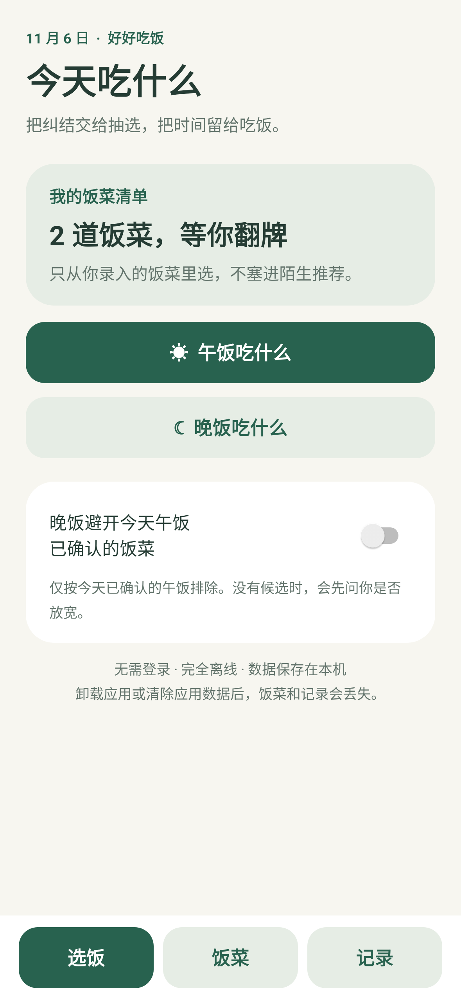
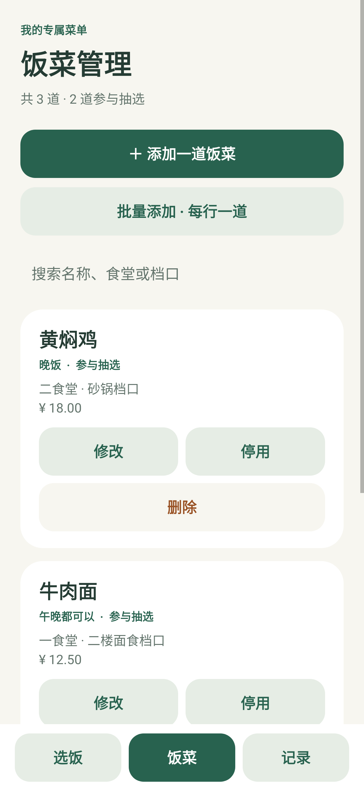

# 今天吃什么 · Android

原生 Android 应用，Java + 系统 SQLite，无运行时第三方依赖。支持 Android 8.0 及以上。没有登录、网络权限、服务器、广告、推荐菜库或聊天功能。首次打开饭菜列表为空。

## 下载安装

**[下载 Android APK](https://github.com/WDNMD318715/today-eat-android/releases/latest/download/TodayEat-v1.0.0.apk)** · [版本发布页](https://github.com/WDNMD318715/today-eat-android/releases/latest)

将 APK 传到手机，用文件管理打开，按系统提示允许该来源安装。无需自行编译。

[安装与使用说明](delivery/安装与使用说明.md) · [验证报告](delivery/验证报告.md)

 

上图来自自动化测试中的 Android 原生视图渲染，并非真机截图；安装包不含示例饭菜。

## 使用

1. 打开「饭菜」，添加一道饭菜，或者选择「批量添加」并每行填写一道。
2. 名称必填；食堂、档口、价格选填，餐次默认「都可以」。批量录入时，选填信息适用于本次所有新增饭菜。
3. 回到「选饭」，点击「午饭吃什么」或「晚饭吃什么」。点「换一个」继续抽选；点「就吃这个」才会记入记录。
4. 在首页可打开「晚饭避开今天午饭已确认的饭菜」。没有候选时，需要你明确同意才会在本轮放宽；不会永久关闭开关。
5. 「饭菜」支持搜索、修改、停用／恢复和删除。停用条目不参与抽选。重复名称（包括已停用饭菜、批量输入内重复）会提醒并阻止重复保存。

日期使用手机本地日期。每天每餐保存一条确认记录，再次确认会先询问是否替换。「记录」展示最近 100 条，旧记录仍保存在数据库中。改名、删除饭菜不影响历史快照。

## 数据说明

饭菜、设置和确认记录保存在应用私有 SQLite 文件 `today-eat.db` 中，保存后关闭应用、结束进程或重启手机不会主动清除。写入使用事务，只有成功保存才展示成功提示。

**卸载应用或在系统设置中清除应用数据，会丢失全部饭菜、设置和记录。** 本版关闭云备份及设备迁移备份，不提供导出功能。升级时应直接安装同一签名的新版本，避免先卸载。

## 项目与构建

- `app/src/main/java/cn/todayeat/app/MainActivity.java`：中文原生界面。
- `MealDatabase.java`：SQLite 持久化、批量事务、历史快照、筛选。
- `MealLogic.java`：餐次筛选、去重名称、价格校验、无立即重复随机抽选。
- `app/src/test/`：抽选规则、真实原生 SQLite 的 Robolectric 重开测试、Activity 交互、原生视图渲染检查。

工具版本固定为 JDK 17、Gradle 8.11.1、Android Gradle Plugin 8.9.2、Android SDK 35。对应兼容要求见 [Android 官方说明](https://developer.android.com/build/releases/agp-8-9-0-release-notes)。

### 在新电脑上生成 APK

1. 安装 Android Studio，将源码 ZIP 解压到简单英文路径，例如 `D:\TodayEat`。
2. 用 Android Studio 打开项目，按提示安装 SDK Platform 35、Build Tools 35.0.0，选择 JDK 17，同步 Gradle（首次构建需要联网下载工具）。
3. 使用菜单中的 Build APK(s)，或在终端运行 `gradlew.bat assembleDebug`。得到 `app/build/outputs/apk/debug/app-debug.apk`，可安装到手机。

完整验证命令：`gradlew.bat testDebugUnitTest lintDebug`。本机已准备工具时，可运行 `powershell -ExecutionPolicy Bypass -File scripts/build.ps1`；脚本用临时盘符处理中文路径，完成后自动恢复。

Release 签名使用本机 `signing.properties` 和 `.signing/` 私钥目录，不放入源码包。后续要覆盖安装交付版，请保留这两个本机文件，并运行 `scripts/build.ps1 -Tasks assembleRelease`。更换签名无法直接覆盖安装旧版。源码 ZIP 中的 debug 构建使用开发签名，与交付版签名不同。

## 验证边界

自动化测试运行于 JVM/Robolectric，包含文件数据库关闭重开与 Android 界面交互。它们不是实体手机重启测试。详情及最终通过数量见交付目录中的「验证报告」。真机首次安装后可按随附验收清单检查手机系统的实际表现。
